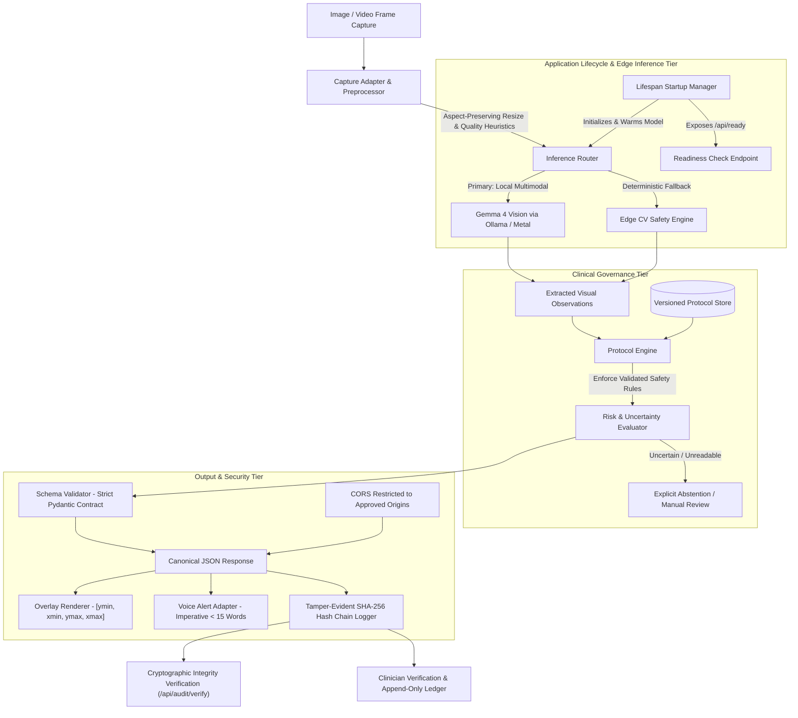

# CareLens Edge-Native Architecture [PROTOTYPE]

## System Overview

**CareLens** is an edge-native clinical visual safety auditing prototype designed to inspect medical equipment and ICU patient monitors in real time. Running directly on edge hardware (such as Apple Silicon Mac with local MLX/Metal execution), CareLens provides millisecond-latency decision-support without transmitting sensitive patient imagery to external cloud servers.

> [!CAUTION]
> **Prototype Governance & Clinical Regulatory Disclaimer**:
> CareLens is an advisory decision-support prototype, NOT a certified medical device.
> Do NOT use to guide real patient care without appropriate clinical, regulatory (FDA / CE-MDR), and safety validation.
> It must never autonomously change equipment settings, control drug infusion, adjust oxygen delivery, or make definitive clinical diagnoses. All findings require qualification and confirmation by a licensed clinician.

---

## Architecture Diagram

---

## Core Components

### 1. Capture Adapter & Preprocessor (`app/capture/`)
- Ingests raw base64 data strings, SVG payloads, or multipart image files.
- Resizes large images (up to 2048px) using aspect-preserving Lanczos interpolation.
- Calculates image quality metrics (mean brightness and contrast standard deviation).
- Evaluates clarity heuristics to catch underexposed (< 20.0), overexposed/glare (> 235.0), and low-contrast (< 12.0 stddev) inputs.

### 2. Application Startup Lifespan & Readiness Check (`app/main.py`)
- Moves model engine loading from module import time to FastAPI application startup lifespan.
- Exposes `/api/ready` to reflect engine readiness and local Gemma 4 model status.
- Restricts CORS to approved origins (no wildcard `*` with credentials).
- Protects file uploads (10MB limit, allowed MIME types) and bounded base64 payloads (15MB).

### 3. Edge Inference Tier (`app/inference/`)
- **GemmaVisionAdapter**: Local multimodal inference adapter formatting prompts with active versioned protocol thresholds and strict JSON schemas.
- **EdgeClinicalEngine**: Orchestrator executing edge visual inspections with fallback mechanisms.
- **Uncertainty & Explicit Abstention**: Enforces that degraded images, unreadable displays, ambiguous equipment, or unparseable vitals produce explicit abstention warnings, never confident unsupported passes.

### 4. Protocol Engine (`app/protocol_engine/`)
- Decouples clinical reference thresholds from AI model reasoning.
- Supports versioned protocols: `adult_icu_v1.0`, `pediatric_icu_v1.0`, `neonatal_icu_v1.0`.
- Evaluates vital sign thresholds and equipment safety rules with exact boundary transitions.

### 5. Tamper-Evident Cryptographic Audit Logger (`app/audit/`)
- Chained SHA-256 cryptographic ledger where each record hashes its predecessor (`previous_hash`).
- Append-only clinician acknowledgements maintaining full hash-chain validity.
- Automated integrity verification method (`verify_integrity()`) exposed via CLI and API.
